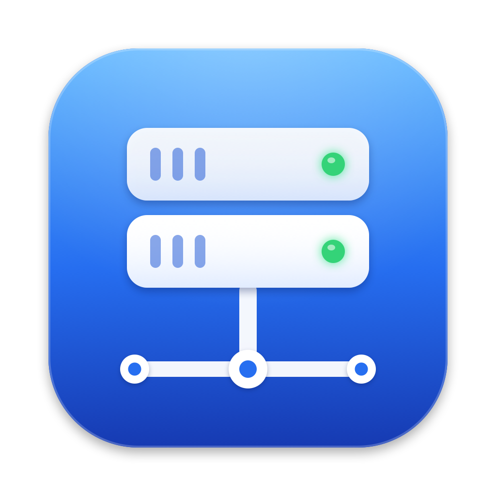

<p align="center">
  
</p>

<h1 align="center">DriveDock</h1>

<p align="center">
  <b>Your network drives, always in Finder.</b><br>
  A small macOS menu bar app that keeps SMB and WebDAV shares mounted —
  reconnects after sleep, Wi‑Fi changes and VPN, and lets you use several accounts on the same server.
</p>

<p align="center">
  <a href="https://github.com/its-sven/DriveDock/releases/latest"></a>
  
  
  <a href="LICENSE"></a>
</p>

---

macOS can mount network shares, but it forgets them: after sleep, after switching networks, or when the VPN comes up later, you are back to *Go → Connect to Server…*. And connecting to the same server as two different users (say, your normal account and an admin account) usually doesn't work at all.

DriveDock fixes that. You set up a server once, and its shares stay in Finder, under a name you choose, ready when you are. It is a free, open-source take on the "always mounted" part of tools like Mountain Duck, built on the Mac's own SMB client.

> **Note:** The user interface is currently in German. English localization is planned — contributions welcome.

## Features

- **Always connected.** Shares are mounted at login and reconnected automatically after sleep, network changes and VPN connects, with a quiet retry every 20 seconds. No error pop-ups.
- **Several users per server.** Each server profile (server + login) gets its own SMB session, so `\\fileserver\Data` can be mounted as *you* and as *admin* at the same time.
- **Clean Finder integration.** Every profile is a folder in `~/Netzlaufwerke` with its own entry in the Finder sidebar, named the way you named it; its shares appear inside.
- **All shares, like Windows.** Optionally mount everything a server offers to that user. New shares show up by themselves, and you can opt out of single ones. Or pick shares by hand from a searchable list loaded from the server.
- **Knows the difference between "wrong password" and "no access".** Shares the user isn't allowed to open are marked *no access* and not retried in a loop. A wrong password stops automatic retries right away, so Active Directory accounts don't get locked.
- **Works on domain-joined Macs.** If the Mac is logged in to Active Directory, macOS likes to use *that* Kerberos ticket instead of the credentials you entered. DriveDock makes sure the account you configured is the one that logs in, or deliberately uses the Mac's domain login if you prefer.
- **LAN and VPN.** Give a server several addresses; the first one that answers is used.
- **Passwords stay in the Keychain** and are never passed on a command line.
- **Native and light.** SwiftUI, Liquid Glass design, a universal binary for Apple Silicon and Intel, no background services besides the app itself.

<!--
Screenshots: add docs/screenshot-menu.png and docs/screenshot-settings.png and remove this comment.

<p align="center">
  
  
</p>
-->

## Installation

### Download

1. Get **DriveDock-x.y.z.dmg** from the [latest release](https://github.com/its-sven/DriveDock/releases/latest).
2. Open it and drag **DriveDock** into **Applications**.
3. Start DriveDock. Because releases are not notarized by Apple yet (that needs a paid developer account), macOS will refuse the first launch. Open **System Settings → Privacy & Security**, scroll down and click **Open Anyway**. Or in Terminal:

   ```bash
   xattr -dr com.apple.quarantine /Applications/DriveDock.app
   ```

DriveDock adds itself to your login items on first launch (you can turn that off in its settings).

### Homebrew

```bash
brew install --cask its-sven/tap/drivedock
```

### Build from source

All you need is the Xcode Command Line Tools (`xcode-select --install`). Full Xcode is not required.

```bash
git clone https://github.com/its-sven/DriveDock.git
cd DriveDock
make signing   # optional, once: local signing identity, see below
make install   # builds, copies to ~/Applications and launches
```

`make signing` creates a self-signed code signing certificate in your login keychain. With it, every build you make keeps the same identity, and macOS only asks once for access to the saved passwords. Without it, builds are signed ad hoc and macOS asks again after every rebuild.

| Command | What it does |
|---|---|
| `make app` | Builds `build/DriveDock.app` for this Mac |
| `make install` | Builds, installs to `~/Applications`, launches |
| `make release` | Universal build plus DMG and ZIP in `dist/` |
| `make icon` | Re-renders the app icon from `scripts/make-icon.swift` |
| `make clean` | Removes build output |

## Usage

1. Click the drive icon in the menu bar → **Server verwalten …** (*Manage servers*).
2. Click **+** and enter the server (`fileserver.example.com` or an IP) and the login. For SMB, load the shares with ↻ and pick the ones you want — or switch on **Alle Freigaben verbinden** (*connect all shares*).
3. Save with **⌘S**. The shares are mounted and the profile shows up in the Finder sidebar.

For a second account on the same server, use **Duplizieren** (*duplicate*) and change the user. Each profile can get its own color.

The menu bar popover shows every profile with its status. The switch keeps a profile connected or disconnects it on purpose (it then stays disconnected until you switch it on again). Click a share chip to open it in Finder.

### Login modes

| Mode | Use it when |
|---|---|
| **Benutzer & Passwort** (*user & password*) | You want a specific account, for example an admin account, or the server is not in your Mac's domain. |
| **Domänen-Login** (*domain login*) | Your Mac is joined to Active Directory and you want to use your Mac login (Kerberos). No password is stored. |

With user & password, DriveDock picks how to reach the server (**Verbinden über**, *connect via*):

- a short NetBIOS domain such as `CORP` → by **IP address**, so the Mac's own Kerberos ticket cannot take over the login
- a DNS-style domain such as `corp.example.com` → by **server name**, so macOS can get a Kerberos ticket for the account you entered

You can force either one per server if a server behaves differently.

## How it works

DriveDock is a SwiftUI menu bar app. Every 20 seconds and on every wake, network and unmount event, it compares what should be mounted with the system's mount table and mounts what is missing.

SMB shares are mounted with `mount_smbfs`, and share lists come from `smbutil view`. That was a deliberate choice over the NetFS API that Finder's *Connect to Server* uses. In testing, NetFS hands every mount to `NetAuthSysAgent`, which:

- sometimes never answers for shares the user may not open — and then blocks **every** further network mount on the Mac, Finder included
- silently falls back to **guest access** when a login fails, so a wrong password can go unnoticed on servers that allow guests
- prefers the Mac's Kerberos ticket over the credentials you pass in

`mount_smbfs` reports *permission denied* and *authentication error* immediately and honestly, and the mount table shows which user is actually logged in. Before mounting, DriveDock checks the login once with `smbutil`. Only if that succeeds does it mount, so a wrong password is never retried share by share.

Both tools only read passwords from a terminal, so they run under `expect` and receive the password through the environment, never as a command line argument. WebDAV shares are mounted through NetFS.

| File | Purpose |
|---|---|
| `ConnectionManager.swift` | Desired-vs-actual reconciliation, reconnect triggers, share discovery |
| `Mounter.swift` | SMB via `mount_smbfs`, WebDAV via NetFS, mount table |
| `ShareBrowser.swift` | Share lists via `smbutil view` |
| `ToolRunner.swift` | Runs CLI tools with a timeout; passwords via `expect` |
| `Keychain.swift` | Passwords in the login keychain |
| `FinderSidebar.swift` | Finder sidebar favorites |
| `MenuView.swift`, `SettingsView.swift`, `DesignKit.swift` | User interface |

## Privacy and security

- Passwords are stored in your login keychain only. Connection settings (no passwords) are in `~/Library/Application Support/DriveDock/connections.json`.
- No network traffic other than to the servers you configure. No telemetry, no update checks.
- A plain-text activity log (status changes and mount errors, never passwords) is written to `~/Library/Logs/DriveDock.log`.
- The app is not sandboxed: it needs to run `mount_smbfs` and `smbutil` and to mount into your home folder.

## Troubleshooting

**"Kein Zugriff" (no access) on a share.** The login works, but the server doesn't allow this account to open that share. Ask your admin or deselect the share.

**"Anmeldung fehlgeschlagen" (login failed).** Wrong user, domain or password. DriveDock stops retrying until you change the credentials or connect manually, so your account doesn't get locked.

**Logged in as the wrong user.** On a domain-joined Mac, set **Verbinden über** to *IP-Adresse*. Check who is logged in with `mount | grep Netzlaufwerke`; the user is shown in front of the server.

**macOS asks for keychain access after every update.** Builds from source: run `make signing` once. Releases: see [docs/RELEASING.md](docs/RELEASING.md).

**Finder or other apps can't mount anything anymore.** That is the `NetAuthSysAgent` hang described above (DriveDock no longer triggers it for SMB). Quit it with `pkill NetAuthSysAgent`; macOS restarts it on demand.

Anything else: check `~/Library/Logs/DriveDock.log` and [open an issue](https://github.com/its-sven/DriveDock/issues).

## Roadmap

- English localization
- On-demand shares through a File Provider extension: shares listed in Finder like on Windows, connected only when opened, offline files
- SFTP and other protocols macOS can't mount natively
- Notarized releases with an Apple Developer ID

## Contributing

Issues and pull requests are welcome. See [CONTRIBUTING.md](CONTRIBUTING.md).

## License

[MIT](LICENSE) © 2026 Sven Würth
